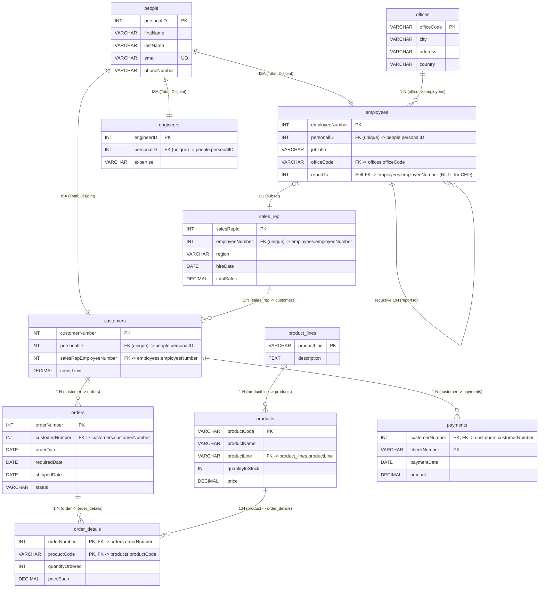
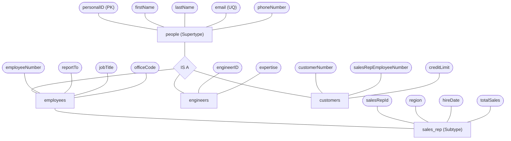

# MySQL ERD Database Design

A comprehensive relational database design and implementation for an enterprise organizational, sales, and fulfillment management system (`company_db`). 

Originally developed as a collegiate database design project by **Matan Elmaliach** and **Daniel Peretz** under lecturer **Nir Regev**, this repository features full normalization, polymorphic entity modeling (ISA inheritance hierarchy), integrity constraints, performance indexes, DBML, Mermaid diagrams, and containerized deployment.

---

## 📑 Table of Contents
- [Architecture & Design Highlights](#-architecture--design-highlights)
- [Entity-Relationship Diagram (ERD)](#-entity-relationship-diagram-erd)
- [ISA Inheritance Hierarchy](#-isa-inheritance-hierarchy)
- [Database Schema Specification](#-database-schema-specification)
- [Repository Structure](#-repository-structure)
- [Getting Started](#-getting-started)
  - [Option 1: Docker Compose (Quickest)](#option-1-docker-compose-quickest)
  - [Option 2: Native MySQL CLI](#option-2-native-mysql-cli)
- [Sample Analytical Queries](#-sample-analytical-queries)
- [Integrity Constraints & Business Logic](#-integrity-constraints--business-logic)

---

## 🌟 Architecture & Design Highlights

1. **Polymorphic People & ISA Hierarchy (Total & Disjoint)**:
   - Base entity `people` stores shared demographic information (`personalID`, `firstName`, `lastName`, `email`, `phoneNumber`).
   - Distinct subtypes (`employees`, `engineers`, `customers`) share a 1:1 foreign-key relationship with `people`.
   - `sales_rep` acts as a specialized 1:1 role specialization of `employees`.
2. **Organizational Hierarchy**:
   - `employees` maintain a recursive self-referential foreign key (`reportTo`) to model manager-subordinate organizational trees.
   - `offices` track physical organizational locations.
3. **E-Commerce & Order Fulfillment**:
   - `product_lines` and `products` model catalog structure with inventory tracking.
   - N:M association between `orders` and `products` is resolved via `order_details` composite primary key (`orderNumber`, `productCode`).
   - Financial tracking through `payments` with composite PK (`customerNumber`, `checkNumber`).
4. **Strict Constraints & Integrity**:
   - CHECK constraints on status values, character lengths, positive prices, credit limits, and logical chronological order dates (`requiredDate >= orderDate`, `shippedDate >= orderDate`).
   - Strategic secondary indexes on foreign keys, email lookups, and query-heavy date ranges.

---

## 📊 Entity-Relationship Diagram (ERD)



A visual image export is also available in [`SQL Course ERD Flowchart, Matan and Daniel.png`](./SQL%20Course%20ERD%20Flowchart,%20Matan%20and%20Daniel.png).

---

## 🧬 ISA Inheritance Hierarchy

The system defines `people` as a supertype with distinct disjoint subtypes:



---

## 🗄 Database Schema Specification

| Table | Primary Key | Foreign Keys | Key Attributes & Constraints |
|---|---|---|---|
| **`people`** | `personalID` (AUTO_INCREMENT) | - | `firstName` (1..30), `lastName` (1..30), `email` (UNIQUE), `phoneNumber` (15) |
| **`offices`** | `officeCode` | - | `city`, `address`, `country` |
| **`employees`** | `employeeNumber` (AUTO_INCREMENT) | `personalID` → `people.personalID`<br>`officeCode` → `offices.officeCode`<br>`reportTo` → `employees.employeeNumber` | `jobTitle` (1..50), recursive hierarchy for managers |
| **`engineers`** | `engineerID` (AUTO_INCREMENT) | `personalID` → `people.personalID` | `expertise` (1..50) |
| **`sales_rep`** | `salesRepId` (AUTO_INCREMENT) | `employeeNumber` → `employees.employeeNumber` | `region`, `hireDate` (<= CURRENT_DATE), `totalSales` (>= 0) |
| **`customers`** | `customerNumber` (AUTO_INCREMENT) | `personalID` → `people.personalID`<br>`salesRepEmployeeNumber` → `employees.employeeNumber` | `creditLimit` (>= 0) |
| **`product_lines`** | `productLine` | - | `description` (TEXT) |
| **`products`** | `productCode` | `productLine` → `product_lines.productLine` | `productName` (1..50), `quantityInStock` (>= 0), `price` (>= 0) |
| **`orders`** | `orderNumber` (AUTO_INCREMENT) | `customerNumber` → `customers.customerNumber` | `orderDate`, `requiredDate` (>= orderDate), `shippedDate` (>= orderDate), `status` IN ('Pending', 'Processed', 'In Process', 'Shipped', 'Cancelled') |
| **`order_details`** | (`orderNumber`, `productCode`) | `orderNumber` → `orders.orderNumber`<br>`productCode` → `products.productCode` | `quantityOrdered` (> 0), `priceEach` (>= 0) |
| **`payments`** | (`customerNumber`, `checkNumber`) | `customerNumber` → `customers.customerNumber` | `paymentDate` (<= CURRENT_DATE), `amount` (> 0) |

---

## 📁 Repository Structure

```text
.
├── CreateProjectTableQuery.sql             # Full DDL schema creation script with documentation and indexes
├── CreateProjectTableQueryNoComments.sql   # Minimal DDL schema creation script
├── InsertQueryIntoProjectDatabaseQuery.sql # Seed data script for initial records
├── init_database.sql                       # Master consolidated script (Drop, Create, DDL, Indexes, Seed)
├── sample_queries.sql                      # Analytical and reporting SQL queries
├── docker-compose.yml                      # Docker Compose specification for MySQL 8.0
├── erdChart.dbml                           # Database Markup Language (DBML) definition
├── mermaidFlowchard.mermaid                # ERD flowchart source in Mermaid syntax
├── ISAflowChart.mermaid                    # People ISA inheritance diagram in Mermaid
├── SQL Course ERD Flowchart, Matan and Daniel.png # High-res rendered ER diagram graphic
├── עבודת הגשה בתכנון וניהול מסדי נתונים...docx  # Original academic project submission document
└── README.md                               # Project documentation
```

---

## 🚀 Getting Started

### Option 1: Docker Compose (Quickest)

Spin up an automated MySQL 8.0 instance pre-populated with schema and seed data:

```bash
docker compose up -d
```

Connect to the container via MySQL client:

```bash
docker exec -it mysql_erd_database mysql -uroot -prootpassword company_db
```

To stop and remove containers:

```bash
docker compose down -v
```

---

### Option 2: Native MySQL CLI

If you already have MySQL 8.0+ installed locally:

```bash
mysql -u root -p < init_database.sql
```

Or run step-by-step:

```bash
# 1. Create tables and constraints
mysql -u root -p < CreateProjectTableQuery.sql

# 2. Insert seed dataset
mysql -u root -p company_db < InsertQueryIntoProjectDatabaseQuery.sql

# 3. Test queries
mysql -u root -p company_db < sample_queries.sql
```

---

## 🔍 Sample Analytical Queries

Included in [`sample_queries.sql`](./sample_queries.sql):

1. **Employee Management Tree**: Resolves employee names, roles, offices, and manager names via self-join and ISA person lookup.
2. **Sales Representative Portfolio**: Computes customer count and sales volume across sales regions.
3. **Order Value Summaries**: Aggregates unit counts and total financial amounts per customer order.
4. **Customer Credit & Balance Audit**: Compares total billed order totals against recorded payments to calculate outstanding balances against credit limits.
5. **Inventory & Category Insights**: Stock levels, distinct product counts, and average pricing per product line.
6. **ISA Disjointness Verification**: Validates the polymorphic role assigned to every individual person in the database.

---

## 🛡 Integrity Constraints & Business Logic

- **Chronological Coherence**: `orders.requiredDate` and `orders.shippedDate` cannot precede `orders.orderDate`. Future dates are prevented via `orderDate <= CURRENT_DATE` and `paymentDate <= CURRENT_DATE`.
- **Financial Bounds**: `payments.amount > 0`, `order_details.quantityOrdered > 0`, `products.price >= 0`, `customers.creditLimit >= 0`.
- **Referential Actions**:
  - `ON DELETE CASCADE`: Removing a `person` cascades to related `employees`, `engineers`, or `customers`. Deleting an `order` cascades to its `order_details`.
  - `ON DELETE RESTRICT`: Prevents orphaned records when attempting to delete `offices`, `customers` with orders, or `products` associated with order history.
  - `ON DELETE SET NULL`: If an employee's supervisor or customer's sales representative is removed, foreign keys safely default to NULL.
